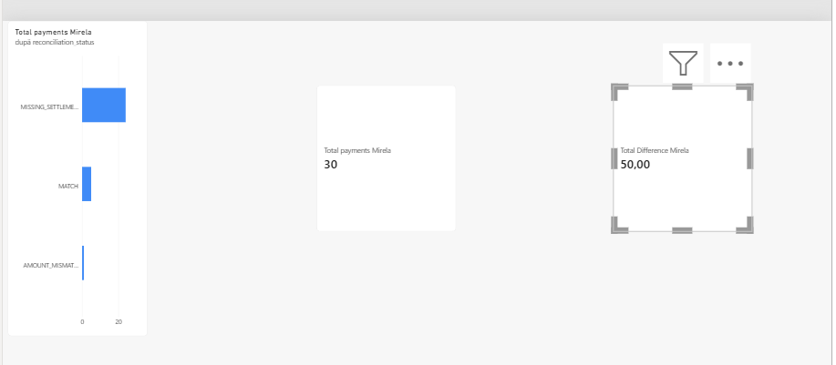

# Banking SQL Analysis – Payment Reconciliation

## Project Overview

This project demonstrates how SQL and Power BI can be used to analyze payment transactions and identify reconciliation exceptions between payments and settlement records.

The objective is to transform banking data into meaningful operational insights by identifying matched payments, amount discrepancies, and payments without corresponding settlement records.

The project simulates a payment operations scenario in which reconciliation controls help identify discrepancies that may require further investigation.

## Business Problem

In payment operations, payment records must be reconciled against settlement records to verify that transaction amounts match and that settlement information is available.

Without effective reconciliation controls, discrepancies may require manual investigation and can affect operational efficiency and the accuracy of financial reporting.

This project addresses three key questions:

* Which payments have been successfully matched with their settlement records?
* Are there discrepancies between payment and settlement amounts?
* Which payments have no corresponding settlement record?

## Tools & Technologies

* **PostgreSQL** – relational database and SQL analysis
* **SQL** – data querying, joins, aggregations, conditional logic, and reconciliation rules
* **Power BI Desktop** – dashboard development and data visualization
* **DAX** – measures for payment counts and amount differences
* **GitHub** – project versioning and documentation

## Database Structure

The project uses a relational banking dataset containing:

* **CUSTOMERS** – customer information
* **ACCOUNTS** – account information
* **PAYMENTS** – payment transaction records
* **SETTLEMENTS** – settlement records associated with payments

The reconciliation analysis links payment records to settlement records using a LEFT JOIN, allowing payments without corresponding settlement records to remain visible in the results.

## Reconciliation Logic

Each payment is classified according to the following rules:

| Status               | Business Meaning                                                            |
| -------------------- | --------------------------------------------------------------------------- |
| `MATCH`              | Payment and settlement amounts match, and the settlement status is SETTLED. |
| `AMOUNT_MISMATCH`    | Payment and settlement amounts differ.                                      |
| `MISSING_SETTLEMENT` | No corresponding settlement record exists.                                  |
| `NOT_SETTLED`        | A settlement record exists, but its status is not SETTLED.                  |

These categories help identify exceptions that may require operational review.

## Key Results

The analysis covers **30 payment records**.

| Reconciliation Status | Number of Payments | Payment Amount |
| --------------------- | -----------------: | -------------: |
| MATCH                 |                  5 |       8,300.00 |
| AMOUNT_MISMATCH       |                  1 |       2,300.00 |
| MISSING_SETTLEMENT    |                 24 |      79,635.00 |
| **Total**             |             **30** |  **90,235.00** |

### Main Findings

* **5 payments matched** their settlement records.
* **1 payment had an amount discrepancy** of 50.00 between the payment and settlement records.
* **24 payments had no corresponding settlement record** in the available dataset.
* Missing settlement records represent reconciliation exceptions requiring investigation; they do not automatically mean that the payments failed.

The amounts are expressed in the dataset's units; no currency is assumed.

## Power BI Dashboard

The Power BI dashboard provides a visual overview of reconciliation results, including the total number of payments, the amount difference, and the distribution of reconciliation statuses.

**Power BI report:** [Open the editable dashboard](payment_reconciliation_dashboard.pbix)

## Skills Demonstrated

* **SQL & Data Analysis:** JOINs, aggregations, CASE statements, and data validation.
* **PostgreSQL:** Relational data querying and creation of a reconciliation view.
* **Payment Reconciliation:** Matching payment and settlement records and identifying reconciliation exceptions.
* **Power BI:** KPI cards, categorical visualizations, and dashboard development.
* **DAX:** Measures for calculating payment counts and total amount differences.
* **Business Analysis:** Translating a payment operations problem into reconciliation rules and meaningful business indicators.
* **Problem Solving:** Using data analysis to highlight discrepancies and support operational investigation.

## Project Files

* `01_database_setup.sql` – database setup and table creation
* `02_banking_analysis.sql` – banking data analysis
* `03_payment_reconciliation.sql` – payment reconciliation logic
* `payment_reconciliation_dashboard.pbix` – editable Power BI report
* `payment_reconciliation_dashboard.png` – dashboard image

## Conclusion

This project demonstrates a practical approach to payment reconciliation using SQL and Power BI. By connecting transaction data with settlement records, the analysis identifies matching payments, amount discrepancies, and missing settlement records.

The results illustrate how data analysis can support payment operations monitoring, exception investigation, and more informed operational decision-making.

*Note: This is a portfolio project based on sample data, not a production banking reconciliation system.*

